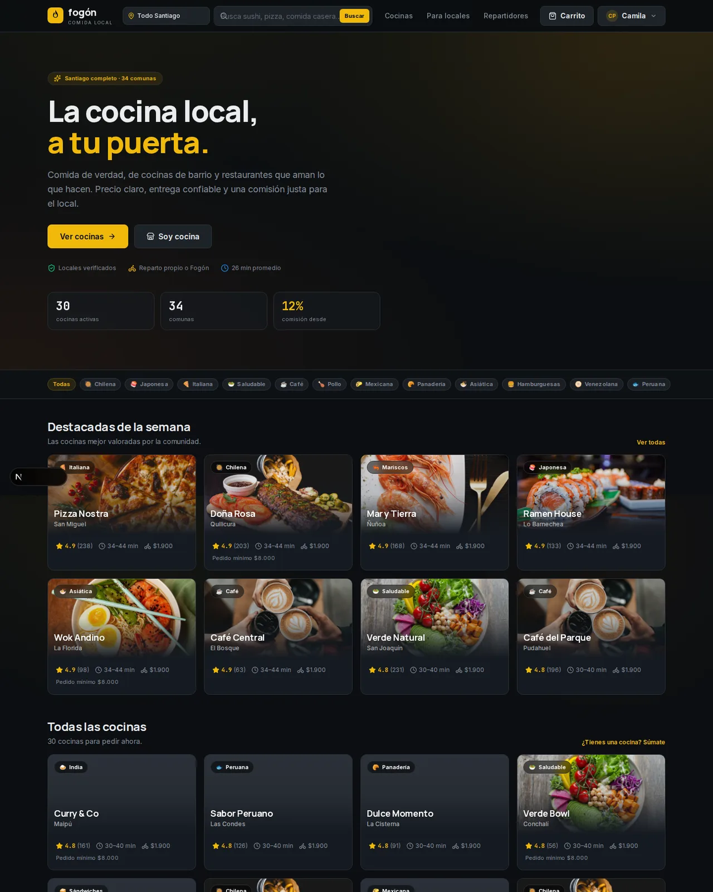
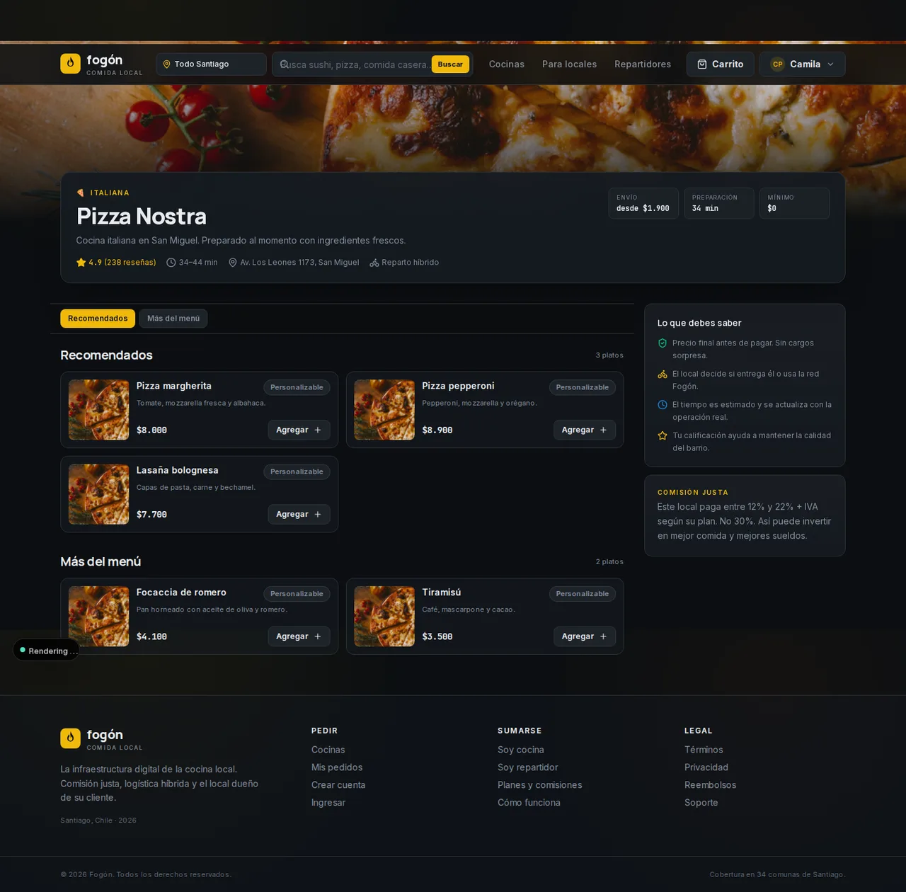
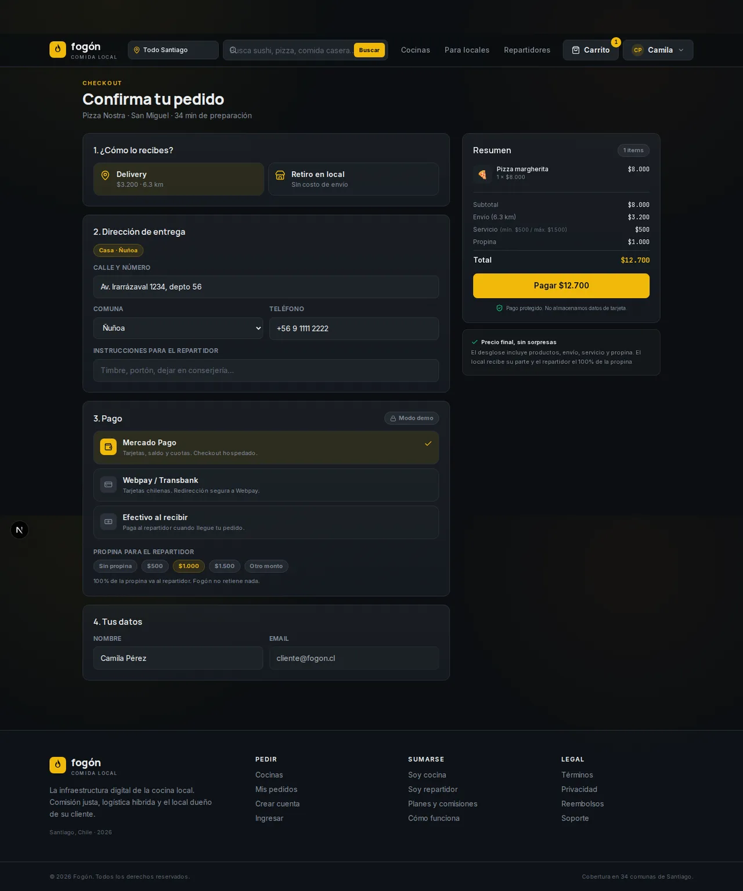
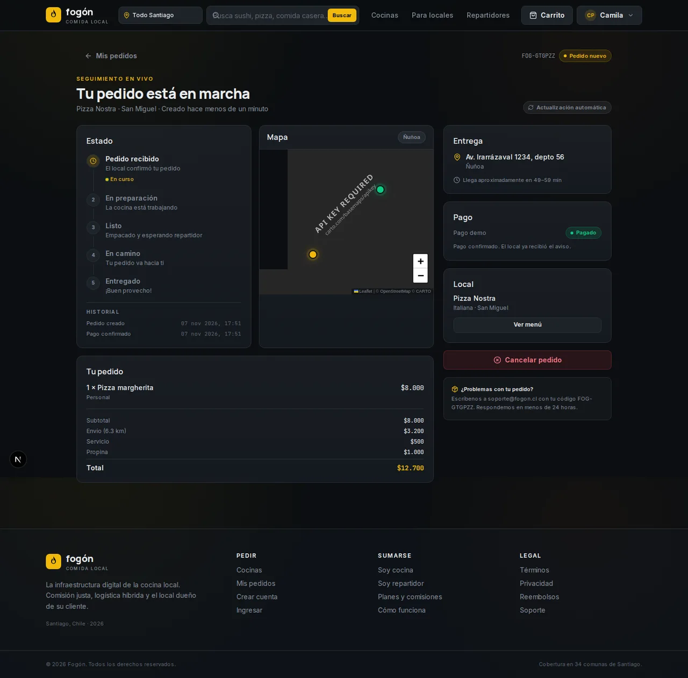
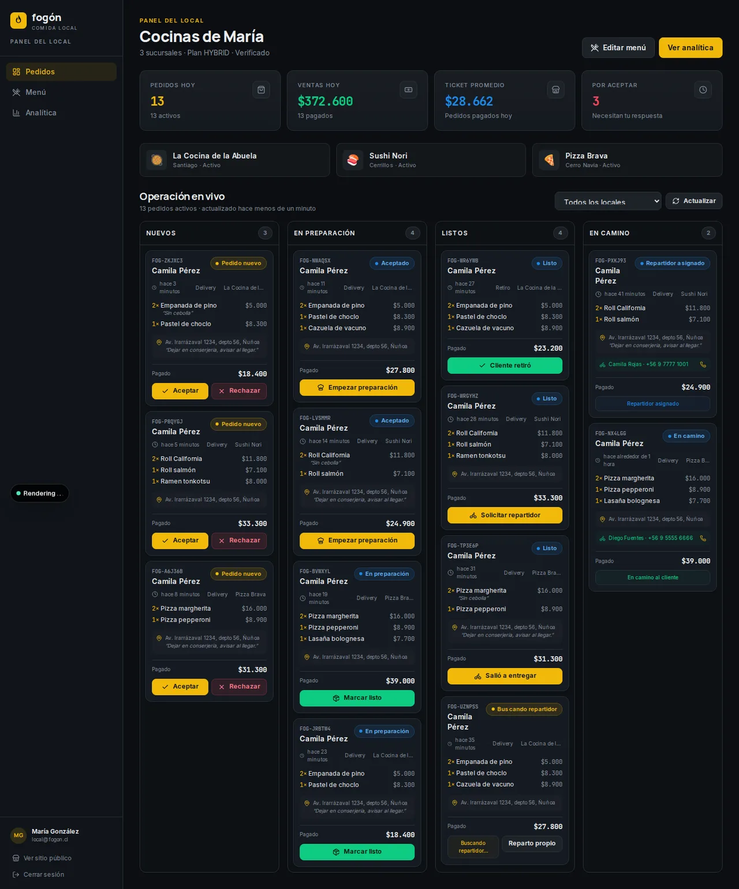
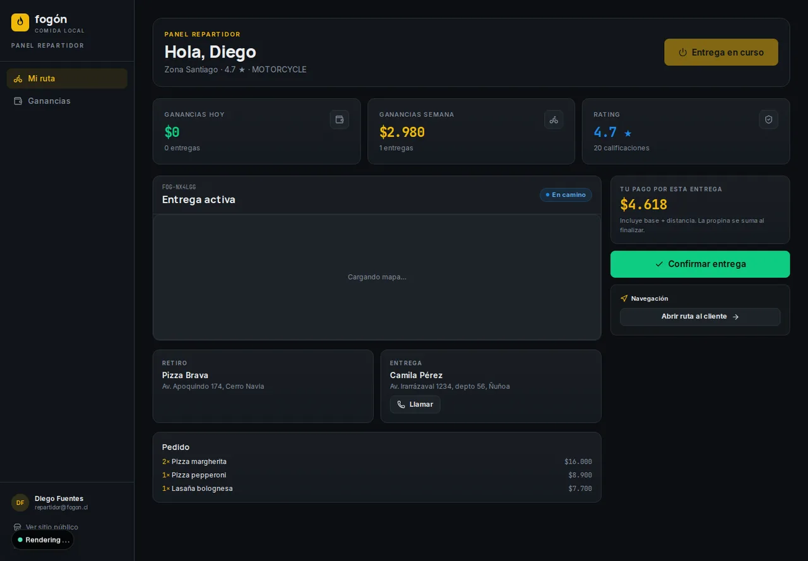
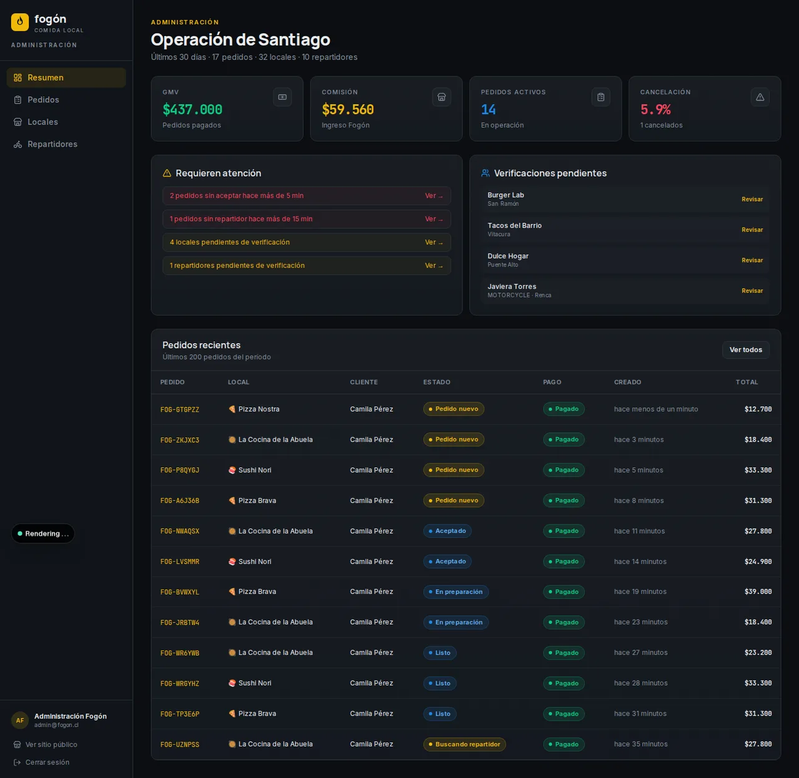
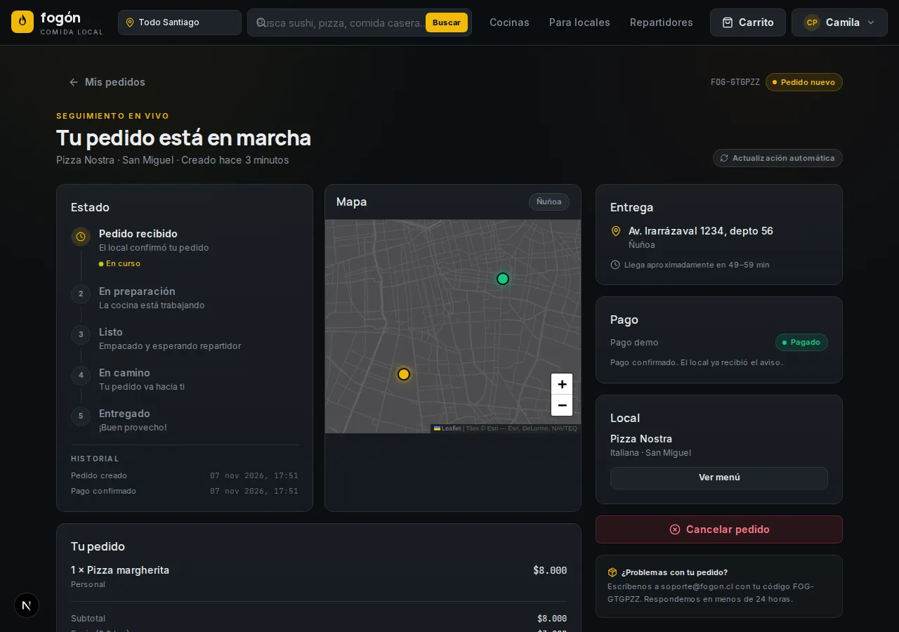

# Fogón

> Una plataforma completa de pedidos, reparto y liquidación para locales de Santiago: cliente, comercio, repartidor y administración en el mismo sistema.



**Software & IA · pedidos y reparto** · **4** roles · **2** versiones · **34** locales demo · **170** platos

## Qué es

Fogón V1 y V2: Next.js, TypeScript, Prisma, app móvil Expo y pagos online. Un repositorio, dos etapas y la historia de lo que cambió.

Las capturas y los datos son de demostración. Las credenciales reales de pago viven en variables de entorno y no se publican.

## El problema

### El pedido no termina cuando sale de cocina.

Un sistema de reparto coordina cuatro agendas distintas y un pago que tiene que cuadrar al final del día.

- El cliente quiere ver el local, armar el carrito y saber cuándo llega. El comercio necesita aceptar, preparar y despachar. El repartidor necesita una ruta y una confirmación. Administración necesita comisiones, incidentes y auditoría.
- Fogón V1 resolvió el ciclo completo con Next.js, Prisma y una app móvil Expo: catálogo, checkout, máquina de estados del pedido, asignación de repartidor, seguimiento y liquidación. La V2 agregó pagos Flow, deshabilitó el efectivo y sumó auditorías, multi-modelo y hardening.
- Este repositorio conserva las dos versiones en carpetas separadas para que la evolución sea legible: no se borró la V1, se puso en contexto.

## Cómo funciona

### Del menú al reparto, con estados claros.

Cada rol ve solo lo que necesita y cada transición deja rastro.

1. **Catálogo** — Locales, categorías, platos, precios y disponibilidad. Los datos seed permiten probar sin depender de un comercio real.
2. **Checkout** — Carrito, dirección, propina y método de pago. La V2 usa Flow online; la V1 acepta Mercado Pago, Transbank y efectivo.
3. **Máquina de estados** — El pedido pasa por creado, aceptado, en preparación, listo, asignado, en camino, entregado o cancelado.
4. **Reparto** — El repartidor recibe una asignación, confirma retiro y entrega. El cliente ve el estado y el mapa.
5. **Liquidación** — Comisiones por rol, propinas y cierre. Administración audita cada movimiento.

## Arquitectura

### Una app, cuatro experiencias.

Next.js concentra la lógica y la API; Expo lleva la operación a terreno; Prisma ordena la persistencia.

`Cliente` (web) → `Next.js` (API + UI) → `Prisma` (PostgreSQL) → `Repartidor` (Expo) → `Pagos` (Flow / sandbox)

- **La base operativa**: Pedidos, reparto, roles, comisiones y pagos con Mercado Pago, Transbank y efectivo.
- **La capa de confianza**: Flow online, efectivo deshabilitado, auditorías, multi-modelo y hardening P0.
- **Pruebas en terreno**: Capturas de escritorio, mobile, QA nativo y e2e; build y lint documentados.

## Capturas


*Home: locales, categorías y platos destacados.*



*Local: menú, disponibilidad y carrito.*



*Checkout: dirección, pago y propina.*



*Pedido: estado y seguimiento.*



*Comercio: pedidos entrantes y preparación.*



*Repartidor: asignación y entrega.*



*Administración: comisiones y auditoría.*



*Mapa: seguimiento del reparto.*

## Stack

Next.js, TypeScript, Prisma, PostgreSQL, Expo, Docker, Caddy, Flow.

La app web y la API viven en Next.js. Prisma modela usuarios, locales, platos, pedidos, pagos y auditorías sobre PostgreSQL. La app móvil usa Expo para el repartidor. El despliegue documentado usa Docker, Caddy y Cloudflare; las credenciales se inyectan por entorno.

## Instalación rápida

```bash
# V2 (recomendada)
cd v2
cp .env.example .env
# Editar DATABASE_URL y los secretos que correspondan
npm install
npx prisma generate
npm run db:push
npm run db:seed
npm run dev
# Abrir http://localhost:3000

# V1
cd ../v1
npm install
npx prisma generate
npm run db:push
npm run db:seed
npm run dev
```

## Estructura del repositorio

```text
fogon/
├── v1/                  # primera versión: pedidos, reparto y pagos manuales
├── v2/                  # segunda versión: Flow, auditorías y hardening
├── docs/                # página, datasheet y developer
├── README.md
└── .env.example         # variables de entorno, secretos en "x"
```

## Límites y decisiones

- **Datos de demostración**: Los 34 locales y 170 platos son seed. No representan comercios reales.
- **Pagos en sandbox**: Flow y los demás medios se documentan con credenciales de prueba; no hay cobros reales en la demo.
- **App móvil**: La app Expo requiere build propio y un dispositivo; no se distribuye como APK en el repo.
- **Dos versiones**: V1 y V2 conviven para comparar. La versión recomendada para operar es V2.

## Preguntas frecuentes

**¿Por qué dos carpetas?**

Porque la V2 cambia pagos y endurece la operación. Conservar la V1 permite entender la evolución.

**¿Qué pago usa la V2?**

Flow online (Webpay, MACH, BCI) y efectivo deshabilitado. La V1 conserva Mercado Pago, Transbank y efectivo.

**¿Se puede probar sin base de datos?**

Sí, con el seed de Prisma y las variables de entorno de ejemplo.

**¿Las capturas son reales?**

Son capturas de la aplicación con datos demo; no exponen datos de clientes.


## Seguridad

Los secretos viven en `.env` y nunca se versionan. El repo incluye `.env.example` con valores `x`. Las cuentas demo usan una contraseña conocida solo para desarrollo; no las uses en producción.


## Documentación

- [Datasheet](docs/datasheet.md): qué hace, cómo se usa y qué límites tiene.
- [Developer](docs/developer.md): arquitectura, archivos y puntos de extensión.
- [Página del proyecto](https://jmadasme.github.io/fogon/): capturas, video y guía visual.

## Seguridad y datos

Los secretos viven en `.env` y nunca se versionan. El repo incluye `.env.example` con valores `x`. Las cuentas demo usan una contraseña conocida solo para desarrollo; no las uses en producción.

Las claves, tokens y contraseñas de ejemplo se publican como `x`. Si vas a desplegar el proyecto, creá tus propios secretos y no los subas al repositorio.

## Licencia

MIT © jmadasme. El código se comparte para estudio y reutilización; los datos de terceros conservan sus propias licencias.
