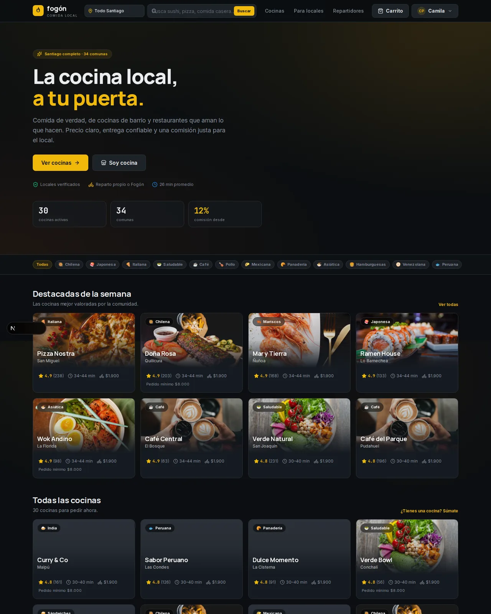
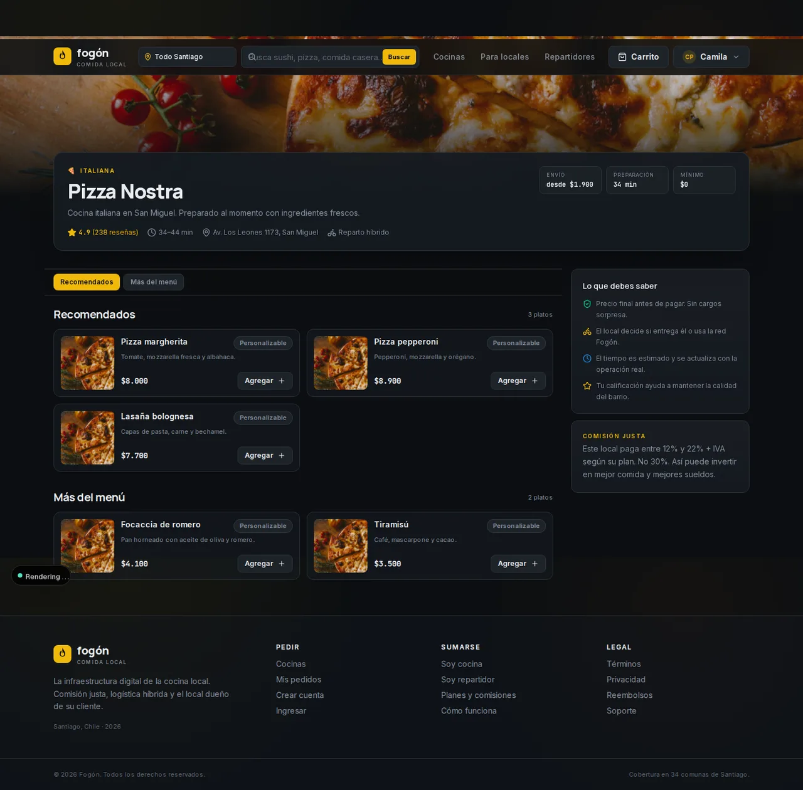
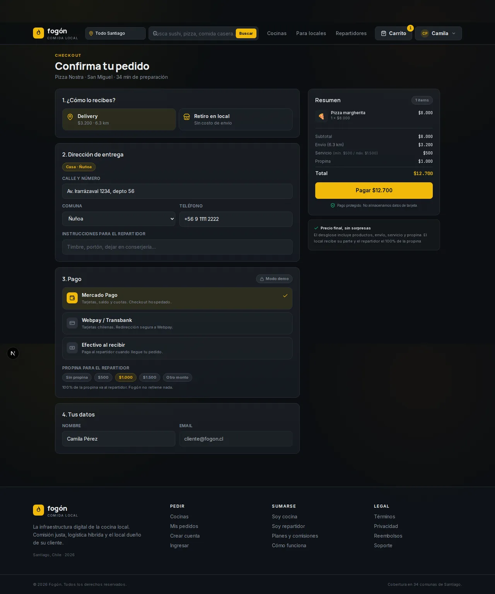
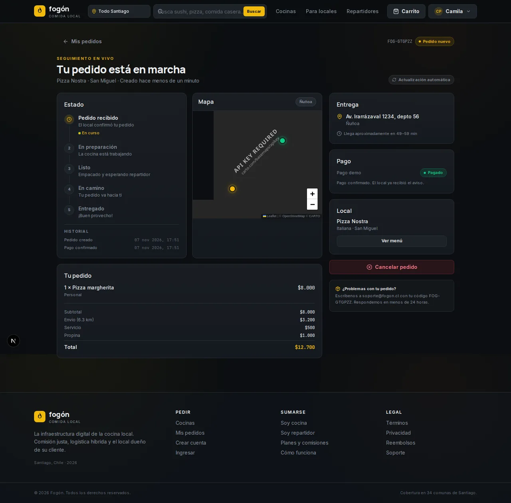
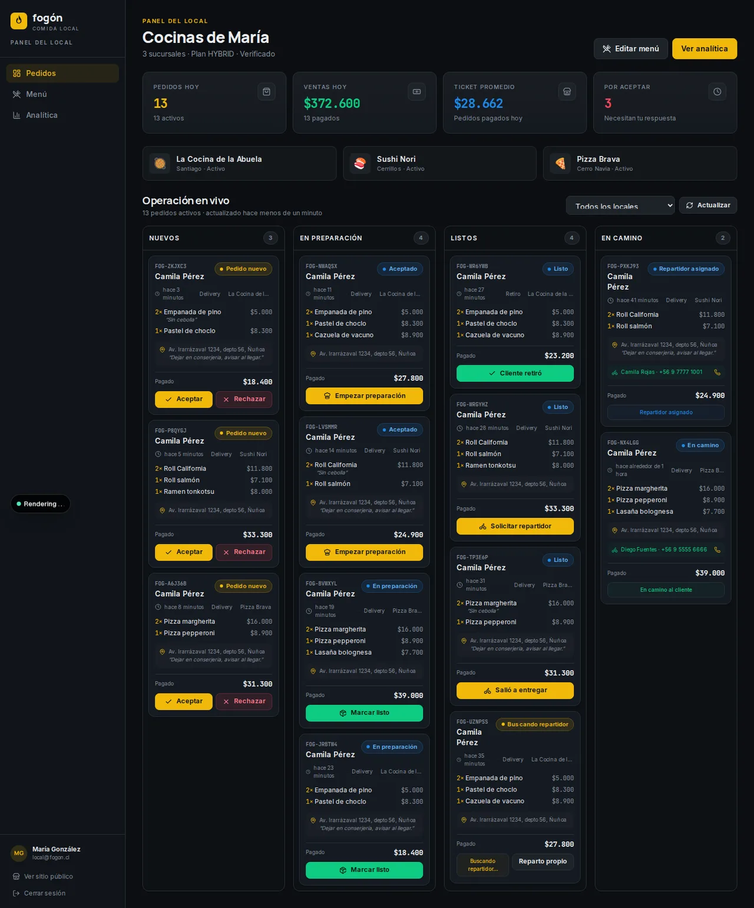
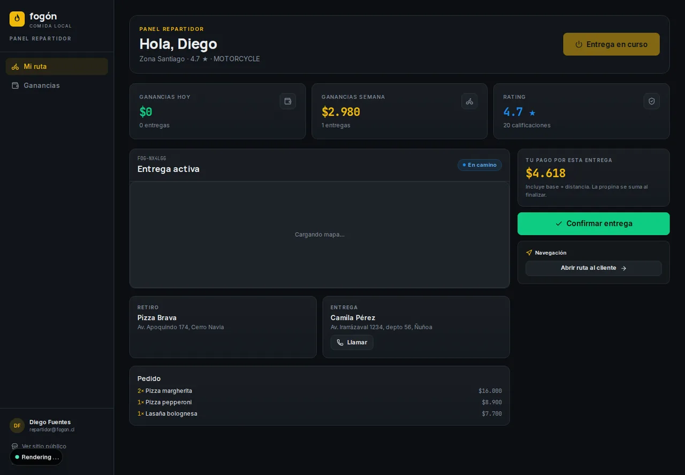
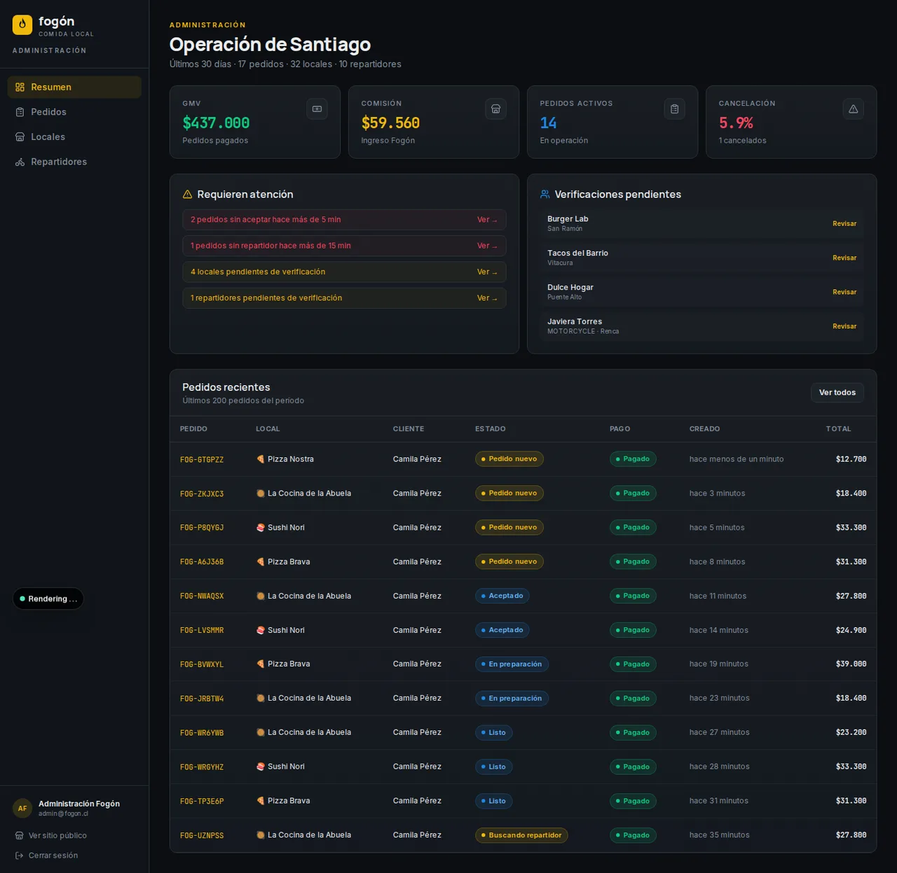
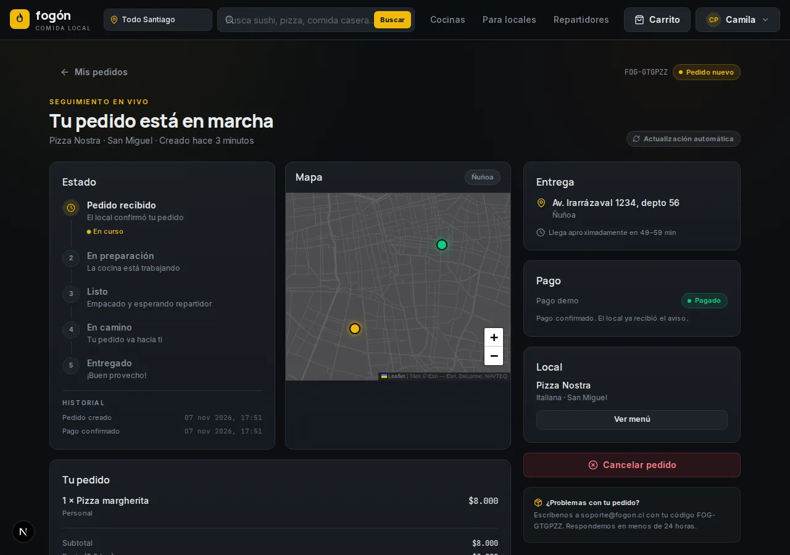

# Fogón · datasheet

**Software & IA · pedidos y reparto**

Fogón — Una plataforma completa de pedidos, reparto y liquidación para locales de Santiago: cliente, comercio, repartidor y administración en el mismo sistema.

## Ficha

| Métrica | Valor |
|---|---|
| 4 | roles |
| 2 | versiones |
| 34 | locales demo |
| 170 | platos |

## Qué resuelve

Un sistema de reparto coordina cuatro agendas distintas y un pago que tiene que cuadrar al final del día.

## Cómo se opera

1. **Cliente** — Explora locales, arma el carrito y elige entrega o retiro.
2. **Comercio** — Recibe el pedido, lo acepta y lo pasa a preparación.
3. **Repartidor** — Ve pedidos disponibles, toma uno y comparte su ubicación.
4. **Administración** — Gestiona locales, comisiones, usuarios y auditoría.

## Flujo técnico

| Etapa | Qué ocurre |
|---|---|
| Catálogo | Locales, categorías, platos, precios y disponibilidad. Los datos seed permiten probar sin depender de un comercio real. |
| Checkout | Carrito, dirección, propina y método de pago. La V2 usa Flow online; la V1 acepta Mercado Pago, Transbank y efectivo. |
| Máquina de estados | El pedido pasa por creado, aceptado, en preparación, listo, asignado, en camino, entregado o cancelado. |
| Reparto | El repartidor recibe una asignación, confirma retiro y entrega. El cliente ve el estado y el mapa. |
| Liquidación | Comisiones por rol, propinas y cierre. Administración audita cada movimiento. |

## Capturas

*Home: locales, categorías y platos destacados.*

*Local: menú, disponibilidad y carrito.*

*Checkout: dirección, pago y propina.*

*Pedido: estado y seguimiento.*

*Comercio: pedidos entrantes y preparación.*

*Repartidor: asignación y entrega.*

*Administración: comisiones y auditoría.*

*Mapa: seguimiento del reparto.*

## Límites

| Límite | Detalle |
|---|---|
| Datos de demostración | Los 34 locales y 170 platos son seed. No representan comercios reales. |
| Pagos en sandbox | Flow y los demás medios se documentan con credenciales de prueba; no hay cobros reales en la demo. |
| App móvil | La app Expo requiere build propio y un dispositivo; no se distribuye como APK en el repo. |
| Dos versiones | V1 y V2 conviven para comparar. La versión recomendada para operar es V2. |

## Preguntas frecuentes

**¿Por qué dos carpetas?**

Porque la V2 cambia pagos y endurece la operación. Conservar la V1 permite entender la evolución.

**¿Qué pago usa la V2?**

Flow online (Webpay, MACH, BCI) y efectivo deshabilitado. La V1 conserva Mercado Pago, Transbank y efectivo.

**¿Se puede probar sin base de datos?**

Sí, con el seed de Prisma y las variables de entorno de ejemplo.

**¿Las capturas son reales?**

Son capturas de la aplicación con datos demo; no exponen datos de clientes.

## Seguridad

Los secretos viven en `.env` y nunca se versionan. El repo incluye `.env.example` con valores `x`. Las cuentas demo usan una contraseña conocida solo para desarrollo; no las uses en producción.

## Enlaces

- [README](../README.md)
- [Developer](developer.md)
- [Página del proyecto](https://jmadasme.github.io/fogon/)
